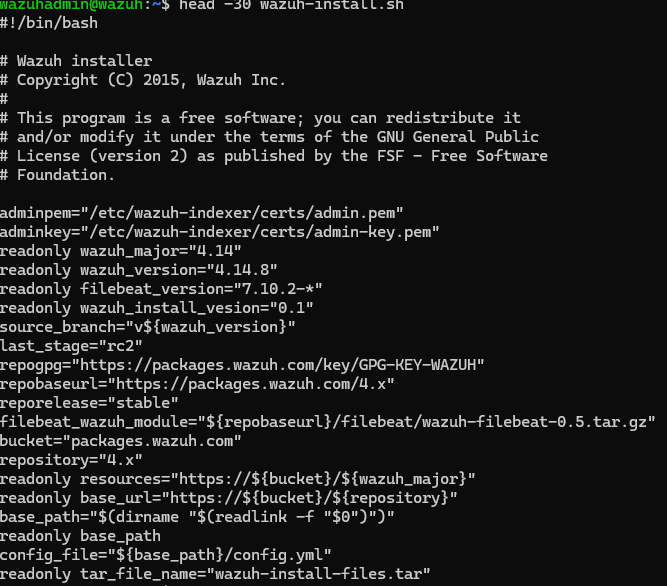
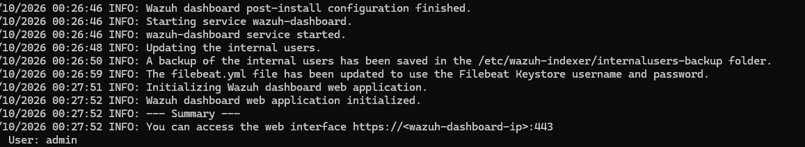
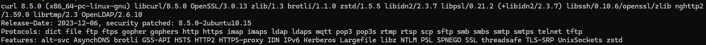
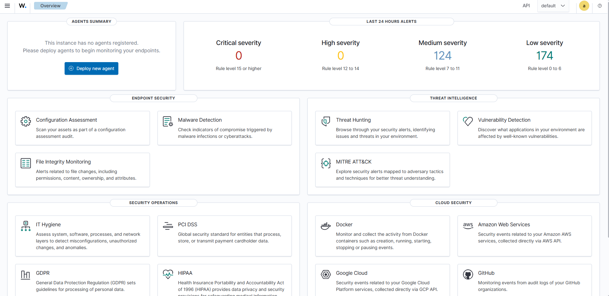
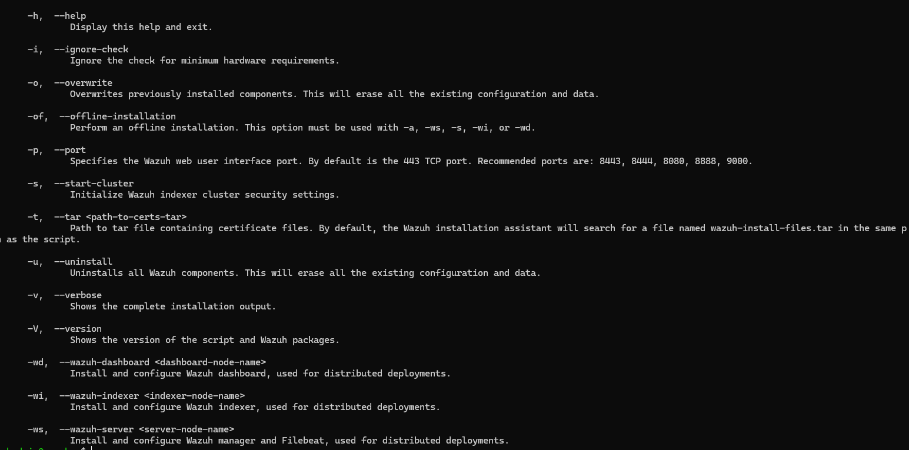

# 01 - Wazuh Installation

## Purpose

Document the Wazuh SIEM server deployed in my Proxmox homelab. This is a record of my learning process, including configuration, verification, problems, and fixes.

## Environment

| Item | Configuration |
| --- | --- |
| Hypervisor | Proxmox |
| VM ID | 103 |
| Operating system | Ubuntu Server 24.04.5 LTS |
| CPU | 4 vCPU |
| Memory | 8 GB |
| Storage | 60 GB |
| Wazuh version | 4.14.8 |
| Components | Wazuh Manager, Indexer, Dashboard |

The VM is connected to the lab environment. Real internal IP addresses are intentionally omitted from this public repository.

## Installation Status

**Completed:** Wazuh 4.14.8 was installed, and the Manager, Indexer, and Dashboard were configured.

### Installation procedure (October 10, 2026)

1. Created a Proxmox snapshot before installing Wazuh.
2. Connected to the Ubuntu server through SSH from Windows PowerShell.
3. Used the all-in-one Wazuh installation command recorded in our installation chat:

```bash
sudo bash wazuh-install.sh -a
```

- `sudo`: run with elevated privileges.
- `bash`: execute the shell script.
- `wazuh-install.sh`: Wazuh installation assistant.
- `-a`: install all-in-one Wazuh components.

The earlier command `head -30 wazuh-install.sh` was used to inspect the script, not to install Wazuh. The exact download command and full installation log are not yet documented.

## Verification

After installation, I was able to use Wazuh for endpoint monitoring. Three agents were connected and active:

- DC01 — Windows Server domain controller
- WIN11 — Windows 11 workstation
- KALI — Kali Linux

Initial Windows security log review included failed sign-in events (Windows Event ID 4625).

## Installation Screenshots

Screenshots collected for review include the installer script header, installer help options, successful dashboard initialization log, first dashboard view (before agent enrollment), and curl version output. The dashboard initialization screenshot confirms the web application started. Screenshots will be added to the repository after reviewing them for sensitive information.


### Uploaded installation evidence

The following five screenshots were uploaded to the repository. Their individual captions will be finalized after matching each uploaded filename to its contents.











## Troubleshooting and Lessons Learned

This section will preserve actual errors, attempted fixes, and successful corrections from the installation. Detailed notes are pending review; I will not invent troubleshooting steps.

## Next Documentation

- Agent deployment and enrollment
- Security event monitoring
- Troubleshooting
- SOC-style incident investigations
